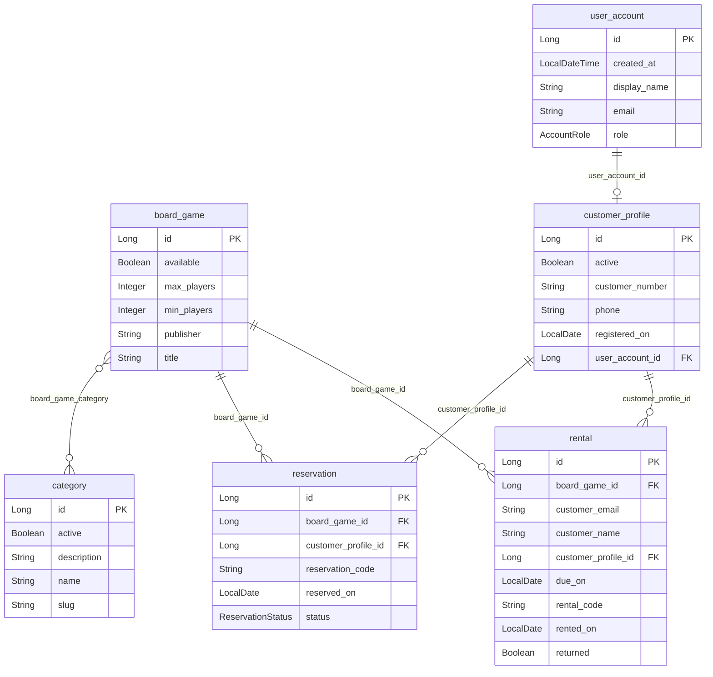

# Schemat bazy danych

Plik generują reguły projektu (panel Maven → Lifecycle → verify). Nie edytujcie go ręcznie.

Tabele: 7 (w tym tabele łączące @ManyToMany: board_game_category) · kolumny: 37 · relacje: 4 × @ManyToOne, 1 × @OneToMany, 1 × @OneToOne, 1 × @ManyToMany

| Tabela | Encja | Kolumny | Klucze obce |
|---|---|---|---|
| board_game | BoardGame | 6 | — |
| category | Category | 5 | — |
| customer_profile | CustomerProfile | 6 | user_account_id |
| rental | Rental | 9 | board_game_id, customer_profile_id |
| reservation | Reservation | 6 | board_game_id, customer_profile_id |
| user_account | UserAccount | 5 | — |

